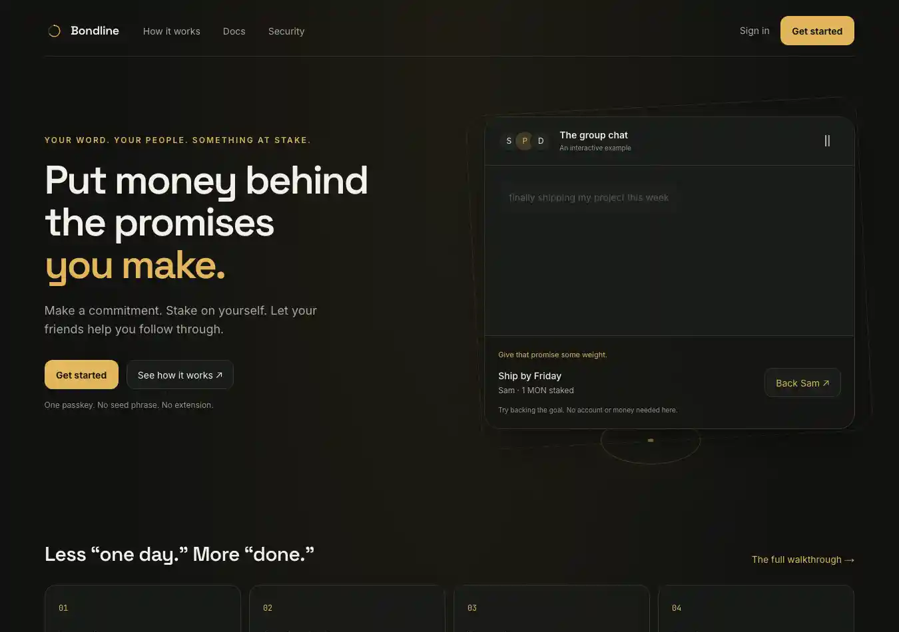
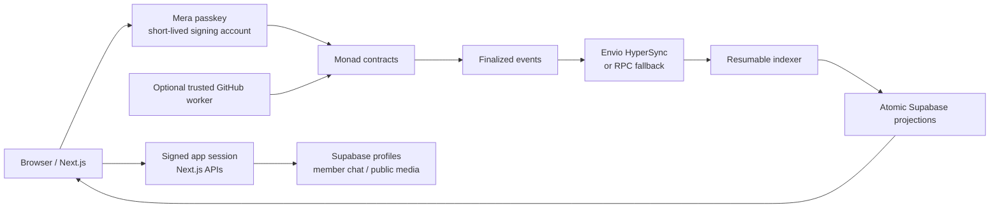

# Bondline

**Put money behind the promises you make.**

Bondline brings goals, financial stakes, social accountability, and verification into one product. Create a Circle with people you trust, choose a deadline and a stake in MON, then prove you followed through. Verified success releases the stake; failure funds the Circle’s shared Pot. Your settled outcomes build a transparent history of follow-through.

[Open Bondline](https://bondline-circle.vercel.app) · [Product guide](https://bondline-circle.vercel.app/guide) · [Documentation](https://bondline-circle.vercel.app/docs) · [Security](https://bondline-circle.vercel.app/security)



Actual rendered homepage; the chat is a labeled interactive illustration. [Mobile view and product captures](docs/assets/README.md).

## The product

- **Circles:** private member conversation, shared goals, invitation/acceptance, identity, and a separate on-chain Pot.
- **Commitments:** a specific goal, stake, deadline, and verification rule, with review before signing.
- **Support and evidence:** backing records encouragement; later evidence approval determines a Circle-reviewed outcome. These are separate actions.
- **Verification:** Circle evidence review and native MON balance checks. A trusted GitHub worker is included but requires authorization, funding, and recurring operation.
- **Rewards:** v2 failed stakes are reserved for deadline-week pools. Completed commitments earn equal shares after the week ends and all its commitments settle.
- **Reliability:** completion rate, settled history, streak, committed amounts, and unique supporters. This is not a credit score.
- **Mera accounts:** passkey-based signing without a seed phrase screen, extension requirement, or custody backend. A browser wallet remains optional.
- **A complete workspace:** personal commitments, Circles, finalized activity, profile, settings, guided onboarding, local notification preferences/read state, and an authenticated export of the user’s profile and authored messages.

The public website uses an animated, explicitly illustrative group-chat hero and a compact product story. Repeated marketing routes redirect into homepage sections; detailed explanations stay in Docs. Verification availability, risk disclosures, privacy, and terms remain accessible. No traction or testimonials are fabricated.

## Deployment

The current v2 manifest targets **Monad testnet, chain ID 10143**, from block **70697469**. Test MON has no cash value. The older v1 mainnet deployment is a separate product version; do not mix its addresses or Pot rules with v2.

| Contract | v2 testnet address |
| --- | --- |
| BondlineCore | `0x7b37d3be163f10af7662e083709aea9102530823` |
| CircleFactory | `0x27c527934b115e64eed61c5f783a1060b540a6c4` |
| Circle implementation | `0xb96f540bf5df893a06670705dc43f40cfc75ada6` |

[Deployment manifest and receipts](docs/deployments/monad-testnet.json) · [Contract reference](https://bondline-circle.vercel.app/docs/contracts)

The account menu and Security page use the configured chain and addresses. The website’s release does not deploy new contracts or move funds.

## Architecture



`BondlineCore` owns escrow, evidence decisions, verification, settlement, refund credits, and weekly reward accounting. `CircleFactory` creates registered Circle clones, each with its own membership and Pot. The core and Circle code are not upgradeable proxies over user funds; the administrator manages the external-verifier registry.

The event pipeline consumes **Envio HyperSync** and has RPC fallback. It is not a deployed HyperIndex/Envio Cloud indexer. The indexer writes finalized projections atomically, with a contiguous cursor and overlap-safe retries. Live contract state remains the authority for actions and accounting.

**CRE code is now included:** a GitHub consensus workflow compiled to WebAssembly, plus a production receiver adapter and tests. It is not deployed or activated on the live app; see [CRE setup](cre/README.md). The Node worker is a separate integration. **Private journal:** Mera’s separate PRF-derived AES-GCM vault encrypts reflections on the device, with explicit lock, encrypted export/import, and recovery limits. Member chat remains access-controlled, not end-to-end encrypted.

## Why Monad

Bondline uses small native-MON stakes and frequent social actions. Monad’s EVM compatibility lets the same Solidity escrow rules and viem tooling serve those flows, while finalized event retrieval keeps profiles and activity tied to settled outcomes. Transaction preparation estimates the full call and adds a small margin because Monad charges on the gas limit. These are implementation choices, not claims of independently measured throughput or guaranteed fees.

## Technology

Next.js 16 / React 19 · TypeScript · wagmi / viem · Mera 0.2 · Solidity / Foundry · Supabase PostgreSQL and Storage · Envio HyperSync · Chainlink CRE SDK · Vercel.

## Run locally

Prerequisites: Node compatible with the current Next.js release, pnpm, and Foundry for contract tests.

```bash
cd web
pnpm install --frozen-lockfile
cp .env.example .env.local
# Configure matching chain, addresses, and social-service values.
pnpm dev
```

Use the same passkey and stable domain to return to the same Mera account. Localhost and production relying-party scopes are different; do not assume a production credential works on an unrelated preview domain.

### Environment

Use [web/.env.example](web/.env.example) and the [environment reference](https://bondline-circle.vercel.app/docs/environment). Public settings include the chain, RPC, contract addresses, Supabase public project values, and optional site/support/video URLs. **Never expose** service-role credentials, session/indexer secrets, HyperSync tokens, GitHub tokens, or verifier private keys through `NEXT_PUBLIC_` values.

Mera’s integration here does not require an app ID. Its relying-party ID defaults to the current hostname. Changing that scope can affect existing credentials.

### Database and jobs

For a **new dedicated v2 database**, run [supabase/bootstrap-v2.sql](supabase/bootstrap-v2.sql). Review individual migrations for existing databases; do not reset an active database blindly.

Configure [supabase/schedule-indexer.sql](supabase/schedule-indexer.sql) with the matching Vault secret and application URL. Then:

```bash
cd web
pnpm indexer:backfill
```

Confirm a successful response and cursor advancement. Installing cron does not repair authentication, schema, or decoding failures. The indexer job does not run GitHub verification or every settlement action. The optional verifier requires its own recurring worker:

```bash
pnpm verifier:check
# Only after reviewing the configured account, chain, condition, and fee:
pnpm verifier:run
```

The broadcast command can spend the worker’s funds. Do not run it as part of a read-only setup check.

### Tests and build

```bash
cd web
pnpm typecheck
pnpm test
pnpm build

# From the repository root:
forge test --root contracts --offline
```

The frontend tests cover transaction preparation/signing, notification eligibility, strict event selection, bounded verifier input, private export authorization/pagination, and public activity query validation. Foundry covers lifecycle, access control, frozen reviewers, backing/review separation, reserved rewards, refund handling, and adversarial paths. Passing tests are not an independent audit.

### Frontend deployment

The existing Vercel project uses **web** as its root directory. Set the intended target’s environment values and rebuild. Public environment values are compiled into a release; changing a Vercel value does not update local `.env.local` or already-built deployments.

Git-triggered releases use the repository version. Vercel CLI releases can upload local source without a Git push, so keep the live deployment and repository aligned. Exclude credentials and private planning documents from release snapshots.

Contract deployment commands are in [contracts/Makefile](contracts/Makefile) and [contracts/README.md](contracts/README.md). Review their target carefully: a mainnet deployment spends real MON. Record and verify new deployments before updating the application configuration.

## Trust and privacy

Contracts are **not independently audited**. Stakes can be forfeited. Smart-contract bugs, infrastructure outages, malicious reviewers or attestors, and loss of signing access remain risks. Bondline is not a bank and does not guarantee productivity, rewards, or refunds outside the contract rules.

On-chain commitments, membership, evidence URIs, and outcomes are public. Display profiles and uploaded images are public. Chat requires server-verified identity and membership but is readable by operators and database infrastructure. Do not share sensitive records in descriptions, evidence, or chat.

[Security](https://bondline-circle.vercel.app/security) · [Privacy](https://bondline-circle.vercel.app/privacy) · [Terms](https://bondline-circle.vercel.app/terms) · [Contact](https://bondline-circle.vercel.app/contact)

## Product walkthrough and assets

The [written product guide](https://bondline-circle.vercel.app/guide) works without a video. The [3-minute recording script](web/public/walkthrough-script.md) specifies narration, shot order, real screen states, consent, and publication requirements. Set `NEXT_PUBLIC_GUIDANCE_VIDEO_URL` only after a real completed recording is available; homepage, onboarding, and guide links then point to it.

The [product capture pack](docs/assets/README.md) includes desktop/mobile homepages, real Circle history, documentation, security, and signed-out Activity/Profile introductions. Private signed-in flows require the account holder’s confirmation.

The lighter homepage scored **100 accessibility and best practices on desktop/mobile**, with **86 mobile performance and 100 mobile SEO** in its latest lab run. Those measurements predate the journal release. The current release passes 27 frontend tests, 100 offline contract tests, 8 CRE SDK runtime tests, TypeScript checks, a 46-page Vercel production build, and CRE WebAssembly compilation. See the [release validation](docs/release-validation.md) for measurements, route checks, and the remaining manual sign-in/transaction checks. These results are not an independent security audit.

## Project history

Bondline began as a Spark project on Monad with v1 Pot governance. The v2 work targets Metropolis’s consumer product experience, using Mera for accounts and Envio HyperSync for event retrieval. Sponsor or track eligibility is not a claim of award acceptance. CRE must not be claimed as a live DON deployment without its workflow/receiver receipts. The private journal is a genuine non-wallet Mera PRF use; the user reported its live passkey/save/lock/reopen/backup flow working, while bounty eligibility remains an organizer decision.
