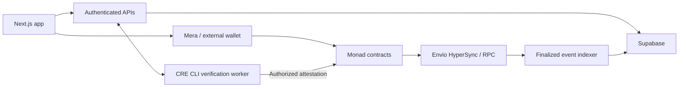

# Bondline

**Put money behind the promises you make.**

Bondline is a social accountability app on Monad. Create a Circle with people you trust, commit to a goal, and stake MON against a deadline. Verified completion returns your stake; missed commitments fund your Circle’s shared Pot.

<!--
## Demo video

[Watch the Bondline demo](DEMO_VIDEO_URL)
-->

[Live app](https://bondline-circle.vercel.app) · [Product guide](https://bondline-circle.vercel.app/guide) · [Documentation](https://bondline-circle.vercel.app/docs)


## How it works

1. Create or join a Circle.
2. Choose a goal, stake, deadline, and verification rule.
3. Work toward the goal with encouragement from your Circle.
4. Submit evidence or check progress using the selected verifier.
5. Complete and verify before the applicable cutoff to receive your stake back. Missed commitments fund the Circle Pot.

Backing a commitment records encouragement; approving its evidence is a separate action. Failed stakes fund weekly reward pools, with equal shares per completed commitment after the deadline week ends and all its commitments settle.

## Features

- **Circles:** member chat, invitations, shared commitments, and a separate on-chain Pot.
- **Flexible verification:** community evidence review, native MON balance targets, GitHub commit targets, and direct contract-call evidence.
- **Passkey accounts:** Mera signing with optional external wallet support.
- **Reliability history:** settled outcomes, completion rate, streaks, and supporters.
- **Private journal:** device-encrypted reflections with encrypted backup and restore.
- **Activity and rewards:** finalized on-chain activity, weekly reward accounting, and claims.

GitHub and contract-call verification currently use official Chainlink CRE CLI simulation with an authorized operator signer. They require an operating, funded worker; live Chainlink DON delivery is not deployed. See the [verification guide](cre/PRODUCT.md).

## Tech stack

Next.js 16 · React 19 · TypeScript · wagmi / viem · Mera · Solidity / Foundry · Supabase · Envio HyperSync · Chainlink CRE SDK · Vercel

## Architecture



`BondlineCore` handles escrow, verification decisions, settlement, and rewards. `CircleFactory` creates Circles with independent membership and Pots. Supabase stores social data and indexed projections; contract state remains authoritative for funds and outcomes.

Monad’s EVM compatibility supports Solidity escrow and standard Ethereum tooling. Bondline estimates transaction gas with a small margin because Monad charges based on the gas limit.

## Getting started

Prerequisites: Node.js 22+, pnpm, and Foundry for contract development. CRE tooling requirements are documented in [cre/README.md](cre/README.md).

```bash
pnpm --dir web install --frozen-lockfile
cp web/.env.example web/.env.local
# Configure web/.env.local before starting the app.
pnpm --dir web dev
```

Configure the matching chain, contract addresses, Supabase project, and server secrets using [web/.env.example](web/.env.example) and the [environment reference](https://bondline-circle.vercel.app/docs/environment). Keep secrets out of Git and never expose them through `NEXT_PUBLIC_` variables.

For a new v2 database, apply [supabase/bootstrap-v2.sql](supabase/bootstrap-v2.sql). Product verification additionally requires [supabase/verification-jobs.sql](supabase/verification-jobs.sql). Review migrations before applying them to an existing database.

Configure the [indexer schedule](supabase/schedule-indexer.sql), then run the initial backfill:

```bash
pnpm --dir web indexer:backfill
```

External verification uses a separate worker. Follow the [product verification setup](cre/PRODUCT.md) or the [local CRE simulation guide](cre/README.md). Passkeys are scoped to their domain; localhost and production credentials are not interchangeable.

## Development

```bash
pnpm --dir web typecheck
pnpm --dir web test
pnpm --dir web build
forge test --root contracts --offline
```

## Deployment

The current deployment uses **Monad testnet**, chain ID **10143**. Test MON has no cash value.

| Contract | Address |
| --- | --- |
| BondlineCore | `0x7b37d3be163f10af7662e083709aea9102530823` |
| CircleFactory | `0x27c527934b115e64eed61c5f783a1060b540a6c4` |
| Circle implementation | `0xb96f540bf5df893a06670705dc43f40cfc75ada6` |

[Deployment manifest](docs/deployments/monad-testnet.json) · [Source verification](docs/deployments/monad-testnet-verification.json) · [Contract setup](contracts/README.md)

Vercel uses `web` as the project root. Production deploys from pushes to `main`; local edits are published after they are committed, pushed, and successfully built. Use direct CLI deployment only when explicitly requested by the project owner.

## Project structure

```text
web/         Frontend, APIs, indexer, and application tests
contracts/   Solidity contracts and Foundry tests
cre/         CRE workflows, product worker, and local simulation
supabase/    Database schema, migrations, and scheduled jobs
docs/        Deployment records, validation, and product assets
```

## Security and privacy

Contracts are **not independently audited**, and stakes can be forfeited. External verification depends on its configured operator and data source. Reliability metrics are not a credit score.

Commitments, on-chain membership, evidence URIs, and outcomes are public. Profiles and uploaded media are public. Member chat is access-controlled but not end-to-end encrypted; journal reflections are encrypted on the device.

[Security](https://bondline-circle.vercel.app/security) · [Privacy](https://bondline-circle.vercel.app/privacy) · [Terms](https://bondline-circle.vercel.app/terms)

## AI-assisted development

OpenAI Codex/ChatGPT assisted with implementation, debugging, refactoring, documentation, and tests. The project author retains responsibility for product decisions, review, and validation.

## License

[MIT](LICENSE).
