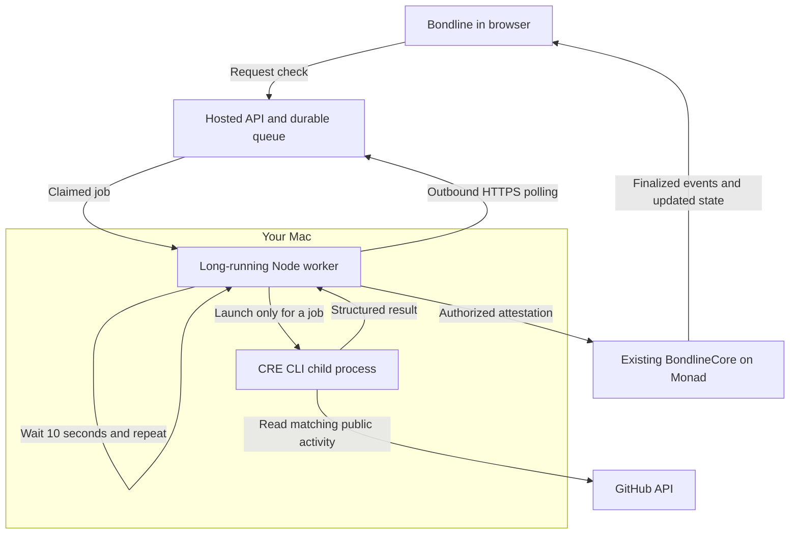

# Product verification in Bondline

## Two execution modes

**Product mode for the hackathon:** Bondline UI → authenticated app job → long-running worker on the operator's Mac → official CRE CLI simulation → bound progress result → explicitly trusted EOA attestation → deployed Monad testnet Core settlement → finalized Envio/RPC projections → UI.

This mode does not require live CRE deployment access. It is not a DON-signed attestation: the authorized service operator is trusted to run the official workflow faithfully. The production CRE forwarder receiver is never made permissive to accept simulator metadata. The Core escrow contract remains unchanged and contains no GitHub logic.

**Developer mode:** `simulate:local prepare / cli / inspect / expire` remains the separate loopback-only Anvil fork flow documented in README.md. Its receipts and synthetic MON are not live Monad receipts.

The workflow also retains authenticated HTTP-trigger support and optional authenticated on-chain progress reports for a future deployed DON. These are not enabled by the hackathon product bridge. `web/scripts/cre-gateway.mjs` implements the documented signed gateway request format, with recursive canonical JSON, short-lived JWTs and unique replay identifiers.

## Supported rules

- Community review: existing frozen eligible reviewers and submitted evidence.
- Wallet balance: existing native MON balance target and permissionless contract check.
- GitHub: configurable public owner/repository, username, 1–100 commits, optional future activity start. Only matching GitHub API user commits on the default branch within the immutable time window count. Up to ten pages of 30 commits are supported; a truncated observation that cannot establish completion errors rather than inventing a result. This does not prove GitHub account ownership or work quality.
- Onchain activity: one successful direct transaction from the commitment creator to a configured contract on Monad testnet, during the immutable window. The user supplies a transaction hash as evidence. The workflow verifies sender, recipient, success receipt, deployed contract code, timestamp and finalized inclusion. Internal calls and reverted transactions are excluded. Other chains and arbitrary RPC URLs are not supported.

Additional adapters belong in `web/scripts/verifier-adapters.mjs` and workflow capability handlers, not in Core settlement logic. Protocol kind 2 remains the generic External type. Rule JSON is stored by the existing Core and bound by its immutable condition hash. Start defaults to on-chain activation; a future configured start can narrow the window but never admit earlier activity. Deadline remains the authoritative Core deadline.

## Timing rule of the deployed Core

Success must ARRIVE ON CHAIN BEFORE the deadline, not merely be performed beforehand. The existing non-upgradeable Core rejects late success. Check progress with adequate time for finalized evidence, CLI evaluation and the settlement transaction. After expiry the workflow follows the existing failure rule; it does not accept late success. A provider error before expiry leaves a goal active. Missed stakes still follow expiry settlement rules. Supporting retroactive successful verification would require a separately reviewed protocol version.

## Setup

1. Apply the additive `supabase/verification-jobs.sql` migration to Bondline's configured database. This creates a service-only queue with atomic claims, leases and per-goal cooldowns; it does not reset existing data.
2. Configure server-only `BONDLINE_VERIFICATION_WORKER_SECRET` (separate 32+ random characters), `BONDLINE_VERIFICATION_MODE=cli-simulation`, `BONDLINE_VERIFICATION_WORKER_ENABLED=true`. Configure the public `NEXT_PUBLIC_EXTERNAL_VERIFIER_ADDRESS` to the dedicated service signer, and rebuild/deploy the frontend.
3. Run `pnpm --dir cre/github-verifier build`. The worker uses the compiled WASM artifact and official CRE CLI with no `--broadcast` flag.
4. Supply the worker's signer through secure runtime secret management. Never export a MetaMask administrator key to the worker. For a single-session testnet demo, explicitly set `BONDLINE_VERIFICATION_EPHEMERAL_SIGNER=true`; the worker generates a signer only in memory and prints its PUBLIC address. It is lost on restart, so fund minimally and use only test MON. Existing commitments remain bound to the old verifier if that process is lost; they are not migrated silently.
5. With the administrator's MetaMask account, visit `/verification-setup`, verify chain 10143, Core and worker address, and authorize the signer. Fund the dedicated signer with enough test MON for settlement fees. The administrator does not sign individual goal settlements.
6. Start the long-running worker with the existing CRE CLI login:

```sh
# Provide configuration through an ignored local environment or a secret manager.
CRE_CLI_PATH=/absolute/path/to/cre node --env-file=web/.env.local cre/github-verifier/product-worker.mjs
```

The worker polls every ten seconds, processes one leased job at a time and scans five Core IDs per poll for new supported commitments. Known unfinished goals are revisited roughly every minute; total latency grows with queue depth. A full discovery pass takes approximately `ceil(bondCount/5)*10 seconds` plus evaluation time. This is demo-scale scheduling, not a guaranteed SLA. No additional hosted cron is installed. The UI disables external creation when the authorized worker has no recent heartbeat.

7. Confirm the real workflow → settlement → UI flow before claiming live product readiness. A passing build or an accepted job is insufficient.

## Security and boundaries

- Browser requests contain only a commitment ID and optional transaction-hash evidence. They cannot supply success, verifier identity, mutable rule config or settlement payloads.
- Signed app sessions and creator/Circle membership gate manual requests; same-origin checks reject cross-origin requests.
- Queue data is service-only under RLS; atomic leases and a 60-second per-goal cooldown limit duplicate executions. No secrets are in frontend bundles or public queue APIs.
- The worker independently reads finalized immutable rules. CLI results bind chain, Core, commitment ID, adapter, condition hash, verifier, finalized block hash/time and evidence hash.
- The worker rechecks active state and current time before sending. Attestations use normal chain-bound EVM transactions; the Core enforces the configured verifier, immutable condition hash, deadline and one-time status transition. Retried reports cannot settle twice.
- Progress metadata is stored separately from the authoritative on-chain status. The UI never treats progress or gateway acceptance as a confirmed settlement.
- Server completion checks validate settlement event ID/outcome/evidence against the supplied transaction receipt. Indexing is retried through the existing pipeline; live contract state remains the authority.
- The simulator child never receives the settlement key or app worker secret. CLI failures cannot authorize a fabricated success.
- Operator outages, API limits, signer loss and insufficient gas funding can prevent timely completion. This mode is a trusted service, not decentralized CRE verification.

## Demo path

Use a consenting user and a Circle named Builders Circle. Create a specific GitHub goal in the actual app, choose a small test-MON stake, configurable repo/user, target 3, and a deadline with time for settlement. Publish three genuine commits AFTER activation on the repository's default branch. Use Check progress to show an intermediate count and then 3/3. Show Verified, the deployed Monad settlement transaction, stake return (or refund credit under Core rules), updated profile history and finalized Activity. Film an expired separate goal only after its real deadline; do not change the public-chain clock. Keep network/mode visible in technical details. No CRE video is produced until these real states exist.

## Current readiness

The additive migration is applied and service-only access was verified (service RPC 200, anonymous queue read 401). Hosting values are configured and the app is deployed at https://bondline-circle.vercel.app (documentation release dpl_GQizcpBPm4hFFbwBN4j9hLBas9LY). The Mac worker uses an in-memory testnet signer, authorized and initially funded with 0.5 test MON. The public verifier is 0xc361dC272FcfEaA34Ab723e24491691a7B59bA8F, authorized by transaction 0x794d6407f058456d6d3f52475d4ecea462476b6e9732e3b66a00962c163739a9. On October 15, 2026, the user confirmed the app flow worked. Independent read-back confirmed commitment 3 completed (Core status 2), its actual configured GitHub target was 1 commit, and the service recorded 1/1 with settlement transaction `0x6977ed00eaea8ff2c10c222afb4685c922e3d1b602d7b9d8c8127c6af4a864b0`. The settlement receipt succeeded in block 71139430, emitted CommitmentVerified and BondResolved, and historical balance reads confirmed an exact 0.01 MON increase for the creator. This validates the one-commit case; the proposed three-commit demo was not the rule used for this receipt. CRE DON deployment remains unavailable for this account and is not required by the simulation-backed bridge.

## How the Mac worker runs

The operator started `node --env-file=web/.env.local cre/github-verifier/product-worker.mjs` in a long-lived local command session. macOS keeps that Node process running independently of the Bondline browser tab. It is not an installed launchd service, and this setup has no automatic boot start, crash restart, or sleep-prevention service. “Always-on” describes the uptime required from an operator host, not a guarantee supplied by this Mac setup.

The code's `do … while (!stop)` loop sends an authenticated outbound HTTPS request to the hosted jobs API, claims at most one job, handles it, waits ten seconds with `setTimeout`, and repeats. Empty polls do not launch CRE. For a job, Node starts the official CRE CLI as a child process, supplies a temporary public rule configuration and precompiled WASM, captures its structured result, and removes the temporary config afterward. It validates the result against Monad and, when settlement is permitted, signs and broadcasts the attestation through Monad RPC. Progress goes back to the hosted API. No inbound public port, public IP, or router port forwarding is needed. The Mac is not a Monad blockchain node.



| Event | Effect |
| --- | --- |
| Close the Bondline browser tab | The separate worker can keep processing. |
| Mac sleeps or loses internet | Checks pause or fail to reach services; queued requests remain in the hosted database. Deadlines keep advancing on Monad. |
| Mac wakes with the same process alive | Polling can resume with the same in-memory signer. |
| Stop/kill the worker, restart the Mac, or terminate its command session | The process ends. Its ephemeral signing key is lost; restarting generates a different address unless a durable service key is configured. |
| Mac is unavailable | The hosted website, queue and on-chain escrow remain online; this Mac's external checks and attestations are unavailable. Native balance checks and community review do not require this worker. |

A worker heartbeat helps the app detect recent polling and disable new external commitments when unavailable. It does not reserve future uptime or extend a deadline. Do not terminate an ephemeral worker while commitments still depend on it. The next operational milestone is an independent host with a securely recoverable service signer, process supervision and monitoring; it does not require DON deployment access.
