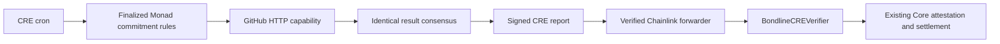

# Bondline CRE GitHub verification

This package implements a real Chainlink CRE workflow using HTTP, consensus, finalized EVM reads, report generation, and EVM report delivery. It compiles to WebAssembly. Its tests run through the official SDK's capability/runtime harness. A separate Solidity receiver connects authenticated reports to the existing v2 Core's `attest` entry point.

**Operational status:** the official authenticated CRE CLI end-to-end LOCAL simulation passed with real GitHub HTTP evidence, consensus/report delivery, a verified 0.01 local-MON refund, insufficient-evidence waiting, and deadline failure reserving 0.01 local MON in the Circle Pot. All 104 contract tests pass, including public-chain rejection of the local adapter. The Metropolis requirement accepts a successful CLI simulation or a live deployment; its required demonstration video remains to be recorded. No receiver is registered on the public Core and no workflow is activated on a DON. Local receipts are not live Monad receipts or real-user traction.

## App integration

The simulation-backed product bridge is documented in [PRODUCT.md](PRODUCT.md). It queues checks from the Bondline UI, runs the official CLI on a supervised Mac worker, records progress, and uses a separately authorized EOA for public testnet settlement. This is not a live DON deployment. Hosting/database/signer setup and actual app-to-testnet receipts remain required before claiming the product flow is operating. The local Anvil commands below remain a separate developer mode.

## Data path



The workflow reads the immutable condition rather than trusting a browser-submitted result. Public repository/author/count fields are strictly bounded. The GitHub host is fixed; supplied URLs are never fetched. Unique author commits are counted within creation/deadline bounds, on the default branch. The condition hash is checked. This does not establish ownership of the GitHub author account, and commit author timestamps are GitHub/git data rather than an independent measure of hours worked.

Before the deadline, insufficient evidence waits without submitting failure. GitHub errors fail closed. An expired verification deadline follows the deployed Core's timeout policy and creates a failure report, not a late success. Core replay/deadline checks remain authoritative.

The production receiver requires the configured forwarder **and** the expected workflow owner and encoded workflow name. It supports 64-byte production metadata and compatible 62-byte packed tooling metadata. It never accepts an empty-metadata mock report. It holds no funds and cannot rewrite escrow rules. It is unaudited.

## Local verification

Requirements: Bun >=1.2.21, pnpm, and Foundry.

```bash
pnpm --dir cre/github-verifier install --frozen-lockfile
pnpm --dir cre/github-verifier typecheck
pnpm --dir cre/github-verifier test
pnpm --dir cre/github-verifier build
forge test --root contracts --offline --match-contract BondlineCREVerifierTest
```

`build` invokes the official CRE SDK compiler, checks runtime compatibility, and generates `dist/workflow.wasm`; it is not merely a browser bundle. The compiler downloads and checksum-verifies its Javy toolchain when absent. Generated bundles and local settings are ignored by Git.

## Required external setup

1. Install the [official CRE CLI](https://docs.chain.link/cre/getting-started/cli-installation), create/sign into your CRE account, and obtain deployment access if required. Do not share access tokens or private keys in an issue or chat.
2. After login, run `cre workflow supported-chains --output json` and confirm Monad testnet is enabled for your tenant. Choose a verified **Monad testnet** production forwarder from the [official directory](https://docs.chain.link/cre/guides/workflow/using-evm-client/forwarder-directory). Verify its deployed code. The SDK's Monad testnet selector is `2183018362218727504` (chain 10143). A chain selector is not a forwarder address or proof of production access.
3. Deploy `BondlineCREVerifier(core, productionForwarder, workflowOwner, encodedWorkflowName)` with the actual Core manifest, confirmed private-registry report owner, and workflow name. The receiver is immutable. Register that receiver with `Core.setTrustedVerifier(receiver, true)` using the Core deployer. These are separate, reviewable on-chain actions.
4. The workflow name encoding follows CRE's identity layout: SHA-256 of the UTF-8 name, lowercase hexadecimal, first ten ASCII characters encoded as bytes10. Use the configured `bondline-github` name consistently. Confirm actual report metadata before activating funds-related delivery.
5. Copy `cre/github-verifier/config.example.json` to `config.local.json`; replace the deliberately rejected zero receiver with the deployed receiver. Enter up to five real **External** commitment IDs configured to that receiver. Calibrate `reportGasLimit` against the actual Monad forwarder/receiver path; Monad charges on gas limit, so the example is not a validated live fee estimate.
6. Create a qualifying commitment before making a new GitHub contribution. Set `NEXT_PUBLIC_EXTERNAL_VERIFIER_ADDRESS` to the authorized receiver and rebuild the frontend only after the workflow is operating. A configured address alone does not prove uptime.
7. From `cre/`, inspect and run `cre workflow simulate github-verifier --target staging-settings` without broadcast first. Actual writes need a funded account and explicit `--broadcast`. Production delivery needs workflow activation, not a one-off simulation.
8. Verify the resulting commitment's Core state, refund or Pot transfer, `ReportSettled` event, and finalized index projection. Record the real transaction hash and workflow execution reference before making an integration claim.

[CRE simulation docs](https://docs.chain.link/cre/guides/operations/simulating-workflows) · [Consumer receiver contract docs](https://docs.chain.link/cre/guides/workflow/using-evm-client/onchain-write/building-consumer-contracts)

### Simulation limitation

The public MockForwarder described in Chainlink's documentation can omit workflow identity metadata. This production receiver deliberately rejects that path. A successful SDK fixture is a unit test; it does not relax production authentication or prove a live DON. For a public-chain recording, use an authenticated production-compatible forwarder/workflow or clearly demonstrate the separate Node verifier instead. Never disable the receiver's identity checks to manufacture a successful financial demo.

### Existing Node worker

`web/scripts/verifier.mjs` remains a separate authorized EOA worker for GitHub and permissionless balance/expiry handling. It is not CRE. Its public verifier must match the commitment's immutable verifier address; a CRE receiver and an EOA worker cannot silently replace each other on an existing commitment. Authorizing or changing a registry entry does not migrate existing commitments.

## Read-only receiver preparation

This workflow explicitly uses `deployment-registry: "private"`. That registry uses the CRE login session, so no wallet linking or Ethereum registry gas is required. Obtain the login-derived owner from the CLI workflow hash/deployment metadata and its actual production forwarder with `cre workflow supported-chains --output json`. Public onchain registry ownership is a separate optional setup. Deployment access can be checked with `cre account access`. The receiver must bind to the actual report owner; do not guess an address from a browser profile.

Set public configuration in your local shell:

```bash
export BONDLINE_CRE_WORKFLOW_OWNER=0xYourPrivateRegistryWorkflowOwner
export BONDLINE_CRE_FORWARDER_ADDRESS=0xYourTenantProductionForwarder
# Optional if another wallet or Safe deploys the receiver:
export BONDLINE_CRE_DEPLOYER_ADDRESS=0xDeploymentSender
pnpm --dir cre/github-verifier prepare:receiver
```

The command is read-only. It checks chain 10143, the manifest, protocol version, deployed forwarder code, and receiver constructor gas. It writes an ignored `receiver-plan.local.json` with exact constructor/deployment data, a 5% gas margin and observed limit-based fee estimate. It neither loads a key nor submits a transaction. Code at the forwarder address alone does not establish your tenant's permission to use it.

After deploying, set `BONDLINE_CRE_RECEIVER_ADDRESS` and run it again. It checks the receiver's four immutable fields before producing unsigned registration calldata in `registration-plan.local.json`.

**Existing administrator constraint:** this Core has an immutable EOA deployer. Only that address can call `setTrustedVerifier`. Deploying the receiver from a new Safe does not give the Safe registry authority; the actual Core deployer must sign registration. No administrator migration or escrow redeployment is necessary or attempted here.

### CLI build validation

The official CRE CLI v1.38.0 successfully builds this package with `cre workflow build github-verifier --target staging-settings` from `cre/`. The local `bunfig.toml` keeps `bun run cre-compile` on Bun's runtime, including when an unrelated parent project has a broken Node/Bun shim. SDK compilation and official CLI compilation are both verified; neither registers or activates a workflow.

The production Monad testnet forwarder listed in the official directory at preparation time was `0xF8344CFd5c43616a4366C34E3EEE75af79a74482`, and RPC confirmed code at chain 10143. Treat it as a checked directory candidate, not permission to bypass the tenant's supported-chains result. The Core's existing registry authority was `0x0489DB67c9B49C1C813da3C538103926f31BE572`. A provisional constructor dry run estimated 442527 gas including a 5% margin, around 0.04514 test MON at the observed gas price. Regenerate the estimate for the actual report owner/sender; it excludes registration and workflow operation. No funds were moved.

## Authenticated setup check

CLI login succeeded. The tenant's `supported-chains` response includes Monad testnet, selector 2183018362218727504, production forwarder `0xF8344CFd5c43616a4366C34E3EEE75af79a74482`. Deployment access was not enabled, and the CLI submitted an access request during the access check even with `--non-interactive`. Do not use that flag as a guarantee that `account access` is read-only. No linked workflow owner was returned.

An authenticated official CLI simulation ran the compiled workflow against finalized public Core state and returned `Prepared 0 settlement report(s).` for the already-settled commitment 0. The test used an explicitly unused receiver placeholder and no broadcast flag. This establishes the simulator/read path, not GitHub HTTP execution, a signed production report, a deployed receiver, or settlement. Its temporary config is outside the repository and must not be reused for deployment.

Next external steps: complete deployment-access approval; confirm the private-registry workflow/report owner; regenerate the receiver plan using the confirmed tenant forwarder and owner. Keep `NEXT_PUBLIC_EXTERNAL_VERIFIER_ADDRESS` unset until receiver registration and actual workflow operation are verified.

Private-registry correction: wallet linking is not a prerequisite for the configured private registry. Earlier references to absent linked keys were observations about the organization, not blockers for this target. Deployment access and receiver report-owner metadata still require confirmation.

The private-registry configuration was verified by `cre workflow hash` using the login session without a private key. The CLI successfully resolved the private owner and generated workflow hashes. Confirm the exact report-owner metadata before deploying the immutable receiver; wallet-linking output is not the private owner.

## Meaningful local CLI simulation

This path exercises the real CRE CLI against a loopback-only Anvil fork of the verified Monad v2 deployment. It uses actual GitHub HTTP results and the workflow's consensus/report/write capabilities. The local receiver adapter lives under `contracts/test/fixtures` and rejects deployment on either public Monad chain. The production receiver is not weakened. Local funds, identities, receipts and time jumps are not public-chain traction or a live DON.

```bash
# Terminal 1: isolated local fork, never a public broadcast endpoint
anvil --fork-url https://testnet-rpc.monad.xyz --chain-id 31337 --port 8551 --block-time 1 --silent

# Terminal 2, from repository root
forge test --root contracts --offline --match-contract LocalCREReceiverTest
pnpm --dir cre/github-verifier simulate:local prepare
```

Preparation creates two locally escrowed commitments before evidence exists: one requires one real new public commit by Psalmuel01 in Psalmuel01/bondline; the other requires 100 commits and is expected to remain unfinished. Publish a genuine code contribution after preparation; old commits are excluded. The fixture preparation date is the real local commitment creation timestamp, not a rewritten GitHub timestamp.

```bash
# Use the installed official CLI; if not on PATH, supply its executable path.
CRE_CLI_PATH=/path/to/cre pnpm --dir cre/github-verifier simulate:local cli
pnpm --dir cre/github-verifier simulate:local inspect

# Advance only the LOCAL fixture past its deadline and simulate again.
pnpm --dir cre/github-verifier simulate:local expire
CRE_CLI_PATH=/path/to/cre pnpm --dir cre/github-verifier simulate:local cli
pnpm --dir cre/github-verifier simulate:local inspect
```

The runner validates exact loopback RPC, Anvil identity and chain 31337 before every mutation. Its `--broadcast` is confined to that local endpoint and uses PUBLIC deterministic fixture-key material, not a user's or agent's wallet key. No signing key is written to an env file. Local balance is synthetic. The checked-in local RPC target must not be repointed; the runner rejects a changed URL. Config and local-state files are ignored. Do not enable this adapter in Vercel or the live Core.

Inspect real local Core outcomes: the qualifying goal should reach status 2 and return its stake; insufficient evidence should remain status 0 until expiry; after local expiry the unfinished goal should reach status 3 and reserve 0.01 local MON in the Circle Pot. Those outcomes must be read back before calling a simulation successful. A preflight that simply skips an already-settled public goal does not demonstrate this full path.

### Verified simulation result

The qualifying public commit was `9f6f305`, published after fixture creation. The real CLI returned one successful report with local transaction `0xddb072bb67a63b9e51afc27301372f4e207ddcec48c23e1f625a857f03adcdd6`. Independent state checks confirmed commitment 1 status 2, creator balance increased by exactly 0.01 local MON, commitment 2 status 0, and Pot/reserved balances zero. The 100-commit condition correctly waited after observing one qualifying commit.

After the LOCAL deadline and finality buffer, the CLI returned one failure report with local transaction `0x208afad68a8e27263cb18b1d8b8ade696dca3f3aa290a6ee12cc5e05eceb03e2`. Independent state checks confirmed commitment 2 status 3 and both Circle Pot and reserved Pot exactly 0.01 local MON. Anvil's finalized tag trails by 64 blocks; the helper mines 128 local blocks after setup/time changes so the workflow's finalized-state policy is actually exercised. Production Monad gas calibration and workflow identity authorization are not established by these local tests.

The original source/test/compiler readiness notes are historical; the meaningful CLI simulation now covers both outcomes. Live operation remains unconfigured, and this local adapter must not be enabled in the public app.
